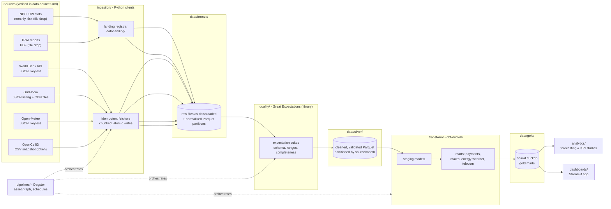

# Architecture (Phase 0, Task 4)

The platform is a single-machine medallion architecture: raw downloads land in **bronze**,
validated/cleaned tables live in **silver**, and dbt-built analytical marts in **gold**,
all backed by Parquet files and DuckDB databases on local disk. Dagster orchestrates the
whole graph; Streamlit serves the product.

## Layers

- **Bronze (`data/bronze/`)** — bytes as downloaded (JSON, xlsx, PDF) next to a normalised
  Parquet partition per source and period (`bronze/upi/month=2026-09/part.parquet`).
  No cleaning beyond parsing; everything else is downstream's problem. Manual landing
  files (NPCI Excel, TRAI PDFs placed in `data/landing/`) are registered into the same
  layout by the ingestion package, so downstream code cannot tell a landing file from
  an automated fetch.
- **Silver (`data/silver/`)** — typed, deduplicated, validated Parquet partitioned by
  source and month. Great Expectations suites (used as a library, not a service) run as
  Dagster assets between bronze and silver; a failed expectation fails the asset, so bad
  data never reaches gold.
- **Gold (`data/gold/bharat.duckdb`)** — dbt-duckdb builds staging views and mart tables
  inside one DuckDB file: `fct_upi_monthly`, `dim_indicator` (World Bank),
  `fct_grid_daily` / `fct_generation_monthly`, `fct_weather_daily`, `fct_towers` /
  `fct_telecom_kpi`. This file is the single serving point for analytics and Streamlit.
- **Orchestration (`pipelines/`)** — Dagster software-defined assets express the whole
  graph (source → bronze → quality → silver → dbt build). `dagster dev` gives the UI,
  schedules (daily Open-Meteo micro-batch, monthly NPCI reminder, quarterly snapshots)
  and automatic dependency ordering. No servers beyond a local webserver process.
- **Serving** — Streamlit reads gold from DuckDB (cheap: marts are pre-joined, small).
  GeoPandas is used in the telecom flagship (spatial join of OpenCelliD tower points
  against state boundaries) and its output is materialised back into gold so the
  dashboard does no heavy geometry at request time.

## Why these tools, given the 8 GB constraint

| Component | Chosen | Instead of | Why it fits 8 GB |
|---|---|---|---|
| Query engine | DuckDB | Spark / Postgres | In-process, columnar, spills to disk instead of dying; no JVM heap, no database server resident in RAM |
| Storage | Parquet + local files | S3/HDFS/data lake | Zero infrastructure; columnar + compression keeps working sets small; partition pruning replaces cluster shuffles |
| Transform | dbt-duckdb | dbt on a warehouse | Same SQL engineering practices (tests, docs, lineage) against the local DuckDB file |
| Orchestration | Dagster | Airflow / Kafka | Single Python process + webserver; asset-oriented model matches medallion flow; no Redis/RabbitMQ/executor farm |
| Validation | Great Expectations (library) | GE Cloud / DataHub | Embedded in the pipeline as plain Python; no metadata service to host |
| Dashboard | Streamlit | Superset / Tableau | One Python process, reads DuckDB directly; no BI server, no Docker |
| Spatial | GeoPandas | PostGIS | Loads only the India subset (filtered before geometry ops); results cached to gold Parquet |

## Memory discipline (hard rules)

1. **DuckDB first.** Any aggregation/join over more than ~50 MB of data runs as SQL,
   not pandas. The DuckDB connection is opened with `memory_limit='2GB'`, `threads=4`
   so the OS keeps headroom on the 8 GB machine.
2. **Polars lazy for heavy file work** (`scan_parquet` → predicate/projection pushdown →
   `sink_parquet`), so transformations stream instead of materialising.
3. **pandas only for small frames** (marts, single-city weather, expectation samples),
   with explicit `chunksize` when reading larger text/Excel files (openpyxl
   `read_only=True`).
4. **Partition-wise processing.** Ingestion and silver jobs handle one source-month per
   run; the largest single artifact in memory is one partition, never a whole history.
5. **PDF/Excel extraction is page- and sheet-wise** (TRAI reports are 100+ pages; sheets
   are converted to Parquet one at a time).
6. **Atomic, idempotent writes** (tmp file → rename, deterministic paths) so a re-run
   after a memory failure is safe and cheap.

## What is deliberately absent

Kafka-style streaming, Spark, containers, and external warehouses are all excluded by
the project constraints. The closest streaming analogue is the Open-Meteo micro-batch:
small append-only refreshes on a Dagster schedule. If the platform ever outgrows one
machine, the seams to cut along are: bronze/silver Parquet → object storage, DuckDB →
warehouse, Dagster → a real scheduler — none of the code organisation changes.
